# AI Risk Pattern Detection Backend

*Phase: Increments #3 to N (other). Story-map cards: "As a user, I want the AI to identify behavior patterns that may indicate a non-obvious future risk" (value 300, 8 points); "As a user, I want to validate the AI insights to help train the model with real school data" (value 100, 3 points).*

*This specification defines the backend of AI pattern detection: the nightly analysis, pseudonymization, the model adapter, the insight contract, human validation, and evaluation. Its frontend counterpart is [todo/0038-ai-risk-pattern-detection-frontend.md](0038-ai-risk-pattern-detection-frontend.md), which can be built against the contract below before this ships. It depends on observations and the timeline of [todo/0015-behavioral-observations-backend.md](0015-behavioral-observations-backend.md), the review columns of [todo/0019-observation-severity-review-backend.md](0019-observation-severity-review-backend.md), the `RiskService` of [todo/0021-risk-classification-alerts-backend.md](0021-risk-classification-alerts-backend.md), `CredentialsFileAdapter` and `create_app` from [todo/0010-backend-foundation-and-delivery-hardening-backend.md](0010-backend-foundation-and-delivery-hardening-backend.md), `require_profile` from [todo/0011-access-management-backend.md](0011-access-management-backend.md), `ScopePolicy` from [todo/0013-teacher-class-assignment-backend.md](0013-teacher-class-assignment-backend.md), the export and anonymization of [todo/0017-lgpd-privacy-compliance-backend.md](0017-lgpd-privacy-compliance-backend.md), and `AuditLogger` from [todo/0027-access-audit-log-backend.md](0027-access-audit-log-backend.md). No school can turn it on before its data protection officer (encarregado) answers the questions in _Further Notes_.*

## Problem
The risk alerts of `0021` catch the obvious case: many severe observations in the last 14 days. They miss the slow ones. A student whose records drift from "euforia" to "apatia" over two months, whose three different teachers each logged one mild episode in the same fortnight, or whose records stop entirely after an intense month never trips a 14-day severity rule, and no coordinator reads 800 timelines a week to notice. The school's own data holds these signals, and nobody has the time to look for them.

## Business Vision and Purposes
The coordination and the multidisciplinary team need a second pair of eyes that reads every timeline every night and points at the few worth a human look, with the records that justify it. Every suggestion is checked by a professional, and those checks tell the school, in numbers, whether the AI is worth keeping. The product can claim AI-assisted early detection only if it can show that the AI's hits are confirmed by the people who know the students, that nothing happens to a student because of a machine, and that the school's DPO signed off on what leaves the school.

## Solution
When a school opts in, a job runs every night. It picks the students with recent activity, builds a pseudonymized version of each timeline (no names, no ids, no dates, by default no free text), and asks a language model, through a gateway, for at most 3 behavior patterns, each citing the records behind it. The backend discards any answer that cites records it did not send, uses diagnostic vocabulary, or repeats a pattern already open, and stores the rest as insights. Coordinators and the professionals responsible for the student see the insights, open the cited observations, and mark each one confirmed or discarded with a reason. Nothing else happens automatically: no alert, no risk change, no referral. The validations feed an evaluation per pattern category that the coordinator can read, and categories that keep being discarded stop being generated for that school.

## User Stories
1. As a Coordenador Pedagógico, I want to receive suggestions of students whose records show a slow or non-obvious pattern, so that I can look at them before the situation becomes a crisis.
2. As a Coordenador Pedagógico or Equipe Multidisciplinar professional, I want every suggestion to show the observations that support it, so that I judge it on the records and not on the machine's word.
3. As a Coordenador Pedagógico or Equipe Multidisciplinar professional, I want to confirm or discard each suggestion with a reason, so that the school learns whether the AI helps and the analysis adapts to our reality.
4. As a Coordenador Pedagógico, I want to see, per type of pattern, how many suggestions were confirmed, so that I can decide whether to keep the feature on.
5. As a Coordenador Pedagógico, I want to turn the analysis on only after the school's DPO approved it, and off at any time, so that the school stays in control of its students' data.
6. As a guardian exercising LGPD rights through the school, I want the AI suggestions about my child included in the data export, so that I can know and contest them.

## Implementation Decisions

### Approach: a language model over pseudonymized timelines, not a model trained per school
I chose a hosted large language model (LLM), reached through a gateway adapter, reading one pseudonymized timeline at a time, over a classical machine-learning model trained on each school's data. The deciding factor is volume. A school of about 800 students (an assumption for a mid-sized Brazilian public high school, not measured in our pilots) produces at most a few thousand observations a year, and the outcome such a model would predict, a student becoming critical or getting a high-priority referral within 60 days, happens to perhaps 20 to 60 students a year. Logistic regression's usual floor of about 10 positive events per predictor puts a 20-feature model at 200 positives, 4 to 10 school years of one school's data, with the definition of "critical" shifting under it. Pooling schools to reach that volume would move sensitive data across tenants, breaking the per-school isolation of `0002` and needing a legal basis of its own.

An LLM needs no training data: it reads a sequence and describes what changed, in Portuguese, citing the records. Its failure modes are known and bounded here: it can invent evidence (every citation is checked against what was sent), drift into clinical language (a vocabulary filter rejects it), and vary between runs (temperature 0, versioned prompts, deterministic inputs). Adding more deterministic rules to `0021` was the other alternative; it is the right tool for the obvious signal, but a rule for each slow pattern is a rule someone has to think of first, which is the problem the card names.

"Help train the model" therefore does not mean updating model weights. The model is never fine-tuned on school data, which would put adolescents' records into a vendor's weights where no anonymization can reach them, and validated cases are never replayed as examples in other students' prompts. Validations train the school's configuration: they produce a labeled evaluation set, suppress categories the school keeps discarding, and inform the next prompt version. They are also the dataset that would let a classical model be revisited once volume allows; see _Further Notes_.

### Pipeline

```mermaid
flowchart LR
  cron["host cron, 02:00"] --> cli["flask insights patterns"]
  cli --> sel["candidate selection (tenant DB)"]
  sel --> pse["Pseudonymizer (in process)"]
  pse --> gw["StructuredModel: LlmGatewayAdapter"]
  gw --> val["output validation"]
  val --> ins[("ia_insights")]
  ins --> api["GET /api/ia/insights"]
  api --> hum["human validation"]
  hum --> eva["evaluation and calibration"]
```


Everything left of the gateway runs inside the tenant's process and database; only the pseudonymized text crosses to the gateway, and only the model's structured answer comes back.

### Batch, not on request
The analysis runs as a Flask command-line command, `flask insights patterns`, registered in `create_app` and scheduled by a host cron entry at 02:00 (America/Sao_Paulo) that runs it inside the web container. The command iterates the active schools of the Master database whose `ia_disponivel` is true, opens each tenant through `database_router.py`, and runs `PatternDetectionJob.run()` where `padroes_ativo` is on. On-request analysis was rejected because it turns the feature into "analyze this student now", which is profiling on demand, puts seconds of model latency on a page load, and makes cost follow clicks. A scheduler inside Gunicorn (APScheduler) was rejected because each of the 2 sync workers would start its own copy, and a database-side scheduler (`pg_cron`) cannot run the Python pseudonymizer or reach the adapter.

A run takes a lock by inserting an `ia_execucoes` row with `status = "em_andamento"`; if one younger than 6 h exists, the run exits. Each model call has a 60 s timeout and 2 retries with exponential backoff on 429 and 5xx; a student whose call still fails is skipped, counted, and retried the next night. The run ends `"concluida"` or `"concluida_com_falhas"`. `ia_execucoes` stores counts and token usage only, never error text, which can echo the input.

### Candidate selection
A student is analyzed when they have at least 3 observations in the last 90 days and either an observation created after their `ia_estudante_analise.analisado_em` or a last analysis older than 14 days. The second condition exists for the `interrupcao_de_registros` category: a student whose records stopped produces no new observation, and would otherwise never be looked at again. Students with `estudante.anonimizado_em` set by `0017` are never candidates. At most 200 students per school per night are analyzed, those with the most new observations first; the rest roll over. This is the data-minimization step (LGPD art. 6, III): an unchanged timeline is sent at most once every 14 days, not every night.

At 800 students we expect 30 to 150 candidates a night (an estimate, not measured). With structured records only, an input is at most 60 records of about 25 tokens plus about 1,100 tokens of prompt and tool definition, roughly 2,600 input tokens and at most 600 output tokens per student, so at most about 390,000 input tokens per school per night. Including free text multiplies the input by about 4.

### What the model sees
`TimelineBuilder` in `src/insights/timeline.py` turns the last 90 days of a student into numbered lines, at most the 60 most recent records. Nothing identifies the student: no name, no id, no class, no age, no absolute date. Records are coded `R1`, `R2`, and so on, and the code-to-id map stays in memory for the run; dates become offsets from today plus the weekday; authors become `D1`, `D2` (teachers) or `C1` (coordination), consistent within one timeline only. Severity is `gravidade_validada` when present, else `gravidade`, as in `0021`. The student's current level, as `RiskService` of `0021` computes it, is included so the model can skip what the rule already flags.

```
Risco atual (regra dos últimos 14 dias): moderado
Janela: últimos 90 dias (dia 0 = hoje)
R1 | dia -84 (seg) | observação | tipo: euforia | gravidade: Baixa | autor: D1 | registro rápido
R2 | dia -61 (ter) | ocorrência da coordenação | tipo: Conflito entre Alunos
R3 | dia -40 (qua) | encaminhamento | status: Em Atendimento | prioridade: Alta
R4 | dia -12 (seg) | observação | tipo: apatia | gravidade: Média | autor: D2
```

Occurrences carry only their `tipo`, one of the fixed values of `0015`; their `acao` and `descricao` are free text and are never sent, not even with the free-text option, because they often record what the family told the coordination. Class-level occurrences, which `0015` shows in every student's history of the class, are included the same way. Referrals carry only `status` and `prioridade`, never `motivo`.

Free text (`descricao` of observations) is sent only when the school also turns on `incluir_texto_livre`. It then passes `Pseudonymizer` in `src/insights/pseudonymizer.py` first: every full name, first name, and surname of 3 letters or more from the tenant's `estudante.nome` and `usuarios.nome` is replaced, accent- and case-insensitively on word boundaries, with `[ESTUDANTE]` for the analyzed student and `[PESSOA]` for anyone else; e-mail addresses, phone numbers, CPF-shaped numbers, `matricula` values, and dates become `[EMAIL]`, `[TELEFONE]`, `[DOCUMENTO]`, and `[DATA]`. Over-redaction (a first name that is also a common word) is accepted. Residual risk remains: relatives' names, places, and unique events are not in any list, which is why free text is a second, separate switch with its own DPO question, and why the default sends none. Pseudonymized data is still personal data under the LGPD; this step reduces exposure, it does not take the data out of the law.

Because observations are append-only, the input can be rebuilt from the tenant database given the student and the cutoff time. Each insight stores `corte_em`, the prompt version, and `hash_entrada` (SHA-256 of the exact input text), which lets the school explain any insight later without keeping a copy of what was sent.

### Model-facing text
All Portuguese the model reads lives as named constants in `src/insights/prompts.py`: `PROMPT_SISTEMA_PADROES`, `FERRAMENTA_REGISTRAR_PADROES` (the tool definition), `VERSAO_PROMPT_PADROES = "padroes-v1"`, and `TERMOS_DIAGNOSTICOS_PROIBIDOS`. The adapter holds no wording. Any change to the first two bumps `VERSAO_PROMPT_PADROES`, and evaluation statistics are kept per version.

`PROMPT_SISTEMA_PADROES`:

```
Você apoia a equipe de uma escola brasileira no acompanhamento psicossocial de adolescentes. Você recebe a linha do tempo pseudonimizada de um único estudante: observações de comportamento registradas por professores, ocorrências da coordenação e encaminhamentos, com datas relativas (dia 0 é hoje).

Sua tarefa é apontar padrões de comportamento que possam indicar um risco futuro ainda não evidente. A escola já sinaliza automaticamente quem tem muitos registros graves nos últimos 14 dias; o "Risco atual" informado vem dessa regra. Não repita esse sinal. Procure o que a regra não vê: mudanças lentas ao longo de semanas, troca do tipo de comportamento registrado, relatos semelhantes de professores diferentes, repetição em dias ou períodos específicos, mudanças depois de uma ocorrência ou encaminhamento, ou a interrupção repentina dos registros depois de um período intenso.

Regras:
- Use somente os registros fornecidos. Cada padrão deve citar pelo menos duas observações pelo código (R1, R2...).
- Não faça diagnósticos nem use nomes de transtornos, doenças ou condições de saúde. Descreva comportamentos observados.
- Não sugira condutas, tratamentos ou medidas disciplinares. Quem decide é a equipe da escola.
- Escreva em português, com linguagem respeitosa e sem rótulos sobre o estudante.
- Registre no máximo 3 padrões. Se não houver padrão relevante, chame a ferramenta com a lista vazia: nenhum padrão é uma resposta válida e esperada.
```

`FERRAMENTA_REGISTRAR_PADROES` is the only tool offered, and the call is forced:

```json
{
  "name": "registrar_padroes",
  "description": "Registra os padrões de comportamento encontrados na linha do tempo do estudante. Chame uma única vez, com a lista vazia se não houver padrão relevante.",
  "parameters": {
    "type": "object",
    "properties": {
      "padroes": {
        "type": "array",
        "maxItems": 3,
        "items": {
          "type": "object",
          "properties": {
            "categoria": {
              "type": "string",
              "enum": ["escalada_gradual", "mudanca_de_padrao", "convergencia_de_relatos", "recorrencia_temporal", "reacao_a_evento", "interrupcao_de_registros"],
              "description": "Tipo do padrão: escalada_gradual (frequência ou gravidade crescendo ao longo de semanas), mudanca_de_padrao (troca do tipo de comportamento registrado), convergencia_de_relatos (professores diferentes registrando sinais semelhantes), recorrencia_temporal (repetição em dias da semana ou períodos específicos), reacao_a_evento (mudança depois de uma ocorrência ou encaminhamento), interrupcao_de_registros (registros cessam depois de um período intenso)."
            },
            "titulo": { "type": "string", "description": "O padrão em uma frase curta, sem diagnóstico, com até 140 caracteres." },
            "explicacao": { "type": "string", "description": "O que mudou e em que período, em até 3 frases e 600 caracteres." },
            "registros": { "type": "array", "items": { "type": "string" }, "description": "Códigos dos registros que sustentam o padrão, como R3 e R7, incluindo pelo menos duas observações." }
          },
          "required": ["categoria", "titulo", "explicacao", "registros"]
        }
      }
    },
    "required": ["padroes"]
  }
}
```

### Output validation
`InsightValidator` in `src/insights/validator.py` drops a pattern, counting it in `saidas_rejeitadas`, when: the categoria is unknown or suspended for the school; fewer than 2 cited codes map to observations that were in the input (codes of occurrences or referrals are allowed as context but are not evidence); `titulo` exceeds 140 or `explicacao` 600 characters; either contains a term of `TERMOS_DIAGNOSTICOS_PROIBIDOS` or any name from the tenant roster; a `pendente` or `confirmado` insight of the same student and categoria was generated in the last 30 days; or a `descartado` insight of the same student and categoria cites the same observations or a superset of them. The vocabulary list starts with terms such as "depressão", "transtorno", "TDAH", "bipolar", "autismo", "TEA", "borderline", "esquizofrenia", "diagnóstico", and "suicida", and is reviewed with the school psychologists before the first pilot.

### Tenant tables

```
ia_configuracao:          -- one row, id = 1
  id                   INTEGER    primary key
  padroes_ativo        BOOLEAN    not null default false
  incluir_texto_livre  BOOLEAN    not null default false
  ciente_ripd_por_id   INTEGER    null, references usuarios(id)
  ciente_ripd_em       TIMESTAMP  null
  alterado_por_id      INTEGER    null, references usuarios(id)
  alterado_em          TIMESTAMP  null

ia_execucoes:
  id                     INTEGER     primary key
  tipo                   VARCHAR(12) not null   -- "padroes"
  status                 VARCHAR(25) not null   -- "em_andamento" | "concluida" | "concluida_com_falhas"
  versao_prompt          VARCHAR(20) not null
  modelo                 VARCHAR(80) not null
  iniciada_em            TIMESTAMP   not null
  concluida_em           TIMESTAMP   null
  estudantes_analisados  INTEGER     not null default 0
  estudantes_com_falha   INTEGER     not null default 0
  insights_gerados       INTEGER     not null default 0
  saidas_rejeitadas      INTEGER     not null default 0
  tokens_entrada         INTEGER     not null default 0
  tokens_saida           INTEGER     not null default 0

ia_insights:
  id                 INTEGER      primary key
  estudante_id       INTEGER      not null, references estudante(id)
  execucao_id        INTEGER      not null, references ia_execucoes(id)
  categoria          VARCHAR(30)  not null
  titulo             VARCHAR(140) null       -- null after anonymization or retention erasure
  explicacao         TEXT         null
  periodo_de         DATE         not null
  periodo_ate        DATE         not null
  corte_em           TIMESTAMP    not null
  hash_entrada       CHAR(64)     not null
  texto_livre        BOOLEAN      not null   -- whether free text was in the input
  status             VARCHAR(12)  not null default 'pendente'  -- "pendente" | "confirmado" | "descartado" | "expirado"
  gerado_em          TIMESTAMP    not null
  motivo_categoria   VARCHAR(30)  null
  motivo             TEXT         null       -- at most 500 characters
  validado_por_id    INTEGER      null, references usuarios(id)
  validado_em        TIMESTAMP    null

ia_insight_evidencias:
  insight_id     INTEGER  not null, references ia_insights(id)
  observacao_id  INTEGER  not null, references observacoes(id)
  primary key (insight_id, observacao_id)

ia_estudante_analise:
  estudante_id  INTEGER    primary key, references estudante(id)
  analisado_em  TIMESTAMP  not null
```

The Master `schools` table of `0002` gains `ia_disponivel BOOLEAN not null default false`, set by the Admin AMPARA (`super_admin`) once a data processing agreement with the model vendor covers that school. It is the platform's switch; `padroes_ativo` is the school's. A missing `llm_gateway` entry in `credentials.json` is the deployment's switch: `create_app` then wires no `StructuredModel`, the command exits without analyzing, and every school reads `"disponivel": false`.

### Model adapter
`StructuredModel` is a protocol in `src/insights/model.py` with one method, `call(system_prompt, tool, user_text) -> ModelAnswer` (the forced tool call's arguments plus token counts); it is deliberately generic, so later AI features reuse it. `LlmGatewayAdapter` in `src/adapters/llm_gateway_adapter.py` implements it against an OpenAI-compatible chat-completions endpoint with forced tool calling, temperature 0, and the 60 s timeout, which a LiteLLM-style gateway exposes for most vendors; it reads `base_url`, `api_key`, and `modelo` from the `llm_gateway` entry through `CredentialsFileAdapter`, per [ADR-0003](../adr/0003-secrets-handling-credentials.md). `httpx` is added to `requirements.txt` as the HTTP client. Putting the vendor behind a gateway URL is what keeps the DPO's answer on vendor and region (_Further Notes_) a configuration change rather than a code change, including a self-hosted open-weights model in a Brazilian region if the transfer question rules out a foreign vendor. `src/adapters/mock_structured_model.py` returns scripted answers for tests and local development.

### Who sees what, and LGPD articles 11, 14, and 20
Insights are visible to `gestor_escolar` (all students) and `equipe_multidisciplinar` (students in their `ScopePolicy`), never to `docente`. An unvalidated machine hypothesis about an adolescent, seen by the teachers who face that student every day, invites labeling, against the best-interest principle of art. 14; teachers already see the observations themselves.

No insight triggers anything. It does not change `risco`, create an alert or a referral, or send a notification; it waits in a list someone has to open. That keeps every consequence for the student a human decision, which is the core of what art. 20 protects against; whether showing a suggestion to staff is itself a "decision" under art. 20 is a DPO question below. For the right to explanation, every insight carries its evidence, category, period, prompt version, model, and input hash, and the student export of `0017` includes every insight about the student, in any status, with its validation.

Reads of insights call `AuditLogger.registrar` once per student returned, with `acao` `"ler_insight_ia"`; validations write `"validar_insight_ia"`; configuration changes write `"configurar_ia"` with `estudante_id` null.

`ia_insights` is registered with the anonymization of `0017` through `AnonymizerService.registrar_tabela("ia_insights", ["titulo", "explicacao", "motivo"], "estudante_id")`, so anonymizing a student nulls the text of their insights while category, status, dates, and evidence links stay for evaluation; the insights routes leave out students with `anonimizado_em` set. Independently, the nightly job nulls `titulo` and `explicacao` of insights `descartado` or `expirado` for more than 180 days: a rejected hypothesis about an adolescent has no reason to stay readable. Pending insights expire after 30 days. Clients must therefore accept `titulo` and `explicacao` as `null`.

### Calibration from validations
Statistics are computed per prompt version. When a category has at least 20 validated insights in the school and a confirmation rate below 20%, where the rate is `confirmados / (confirmados + descartados)`, the job stops storing that category for the school, and the evaluation reports it as suspended. A new prompt version starts with no suspensions, because the statistics no longer describe the same instructions.

### `GET /api/ia/insights?status=pendente&estudante_id=25`
The routes of this spec live in a blueprint in `src/routes/ia.py` over an `InsightService` in `src/insights/service.py`, which holds listing, validation, configuration, and evaluation, and receives the session, `ScopePolicy`, `AuditLogger`, and the clock through `__init__`. Accessible to `gestor_escolar` and `equipe_multidisciplinar`; a `docente` gets the 403 of `0011`. `status` defaults to `"pendente"`; `estudante_id` is optional and answers 404 with `"Estudante não encontrado."` when outside the caller's scope. Returns at most 100 insights, newest first. `ativo` is `false` when the school has not opted in, so the client can tell "nothing found" from "not turned on".

```json
{
  "ativo": true,
  "insights": [
    {
      "id": 311,
      "estudante": { "id": 25, "nome": "Lucas Mendes de Oliveira", "turma": "1º Ano A" },
      "categoria": "mudanca_de_padrao",
      "titulo": "Registros passaram de euforia para apatia nas últimas oito semanas",
      "explicacao": "Até o dia -50 os registros eram de euforia e agitação, de dois professores. Desde então, quatro observações de apatia, a mais recente de gravidade Média.",
      "periodo": { "de": "2026-07-28", "ate": "2026-10-25" },
      "evidencias": [
        { "observacao_id": 1188, "data": "2026-08-03", "tipo": "euforia", "gravidade": "Baixa" },
        { "observacao_id": 1342, "data": "2026-10-14", "tipo": "apatia", "gravidade": "Média" }
      ],
      "status": "pendente",
      "gerado_em": "2026-10-26T05:12:00Z",
      "origem": { "versao_prompt": "padroes-v1", "modelo": "modelo-configurado-no-gateway", "texto_livre": false },
      "validacao": null
    }
  ]
}
```

Evidence carries the effective severity and no `descricao`; the reader opens the student's timeline for the text. Once validated, `validacao` is:

```json
{
  "resultado": "descartado",
  "motivo_categoria": "contexto_externo",
  "motivo": "A mudança coincide com a semana de provas e atingiu a turma inteira.",
  "por": { "id": 1, "nome": "Diretor João" },
  "em": "2026-10-27T11:02:00Z"
}
```

### `POST /api/ia/insights/<int:id>/validacao`
Accessible to `gestor_escolar` and to `equipe_multidisciplinar` for students in their scope. A validation is final.

- Request Body: `{"resultado": "confirmado" | "descartado", "motivo_categoria": "...", "motivo": "..."}`. `motivo_categoria` is required for `"descartado"` and must be one of `"ja_conhecido"`, `"evidencia_insuficiente"`, `"interpretacao_incorreta"`, `"contexto_externo"`, `"outro"`; it must be absent or `null` for `"confirmado"`. `motivo` is optional in both cases.
- `resultado` missing or invalid: 400 with `"Informe se o insight foi confirmado ou descartado."`
- a discard without a valid `motivo_categoria`: 400 with `"Informe o motivo do descarte."`
- `motivo` over 500 characters: 400 with `"O motivo deve ter até 500 caracteres."`
- insight missing or outside the caller's scope: 404 with `"Insight não encontrado."`
- insight not `pendente`: 409 Conflict with `"Este insight já foi validado ou expirou."`
- Response Status: 200 OK with `{"sucesso": true, "mensagem": "Insight confirmado. Se a equipe ainda não acompanha o caso, considere registrar um encaminhamento."}` or `{"sucesso": true, "mensagem": "Insight descartado. Obrigado por ajudar a calibrar a análise."}`

### `GET /api/gestao/ia/configuracao` and `PUT /api/gestao/ia/configuracao`
Accessible only to `gestor_escolar`. `GET` returns:

```json
{
  "disponivel": true,
  "padroes_ativo": true,
  "incluir_texto_livre": false,
  "ciente_ripd": { "por": { "id": 1, "nome": "Diretor João" }, "em": "2026-10-20T14:00:00Z" },
  "ultima_execucao": { "concluida_em": "2026-10-26T05:40:00Z", "status": "concluida", "estudantes_analisados": 37, "insights_gerados": 4 }
}
```

`PUT` takes `{"padroes_ativo": true, "incluir_texto_livre": false, "ciente_ripd": true}`.
- turning either switch on while `disponivel` is false: 409 Conflict with `"A detecção de padrões por IA não está disponível para esta escola."`
- turning either switch on without `ciente_ripd: true`: 400 with `"Confirme que o Relatório de Impacto à Proteção de Dados foi aprovado pelo encarregado da escola."`
- `incluir_texto_livre` true with `padroes_ativo` false: 400 with `"Ative a detecção de padrões antes de incluir os relatos escritos."`
- On success, 200 OK with `"Detecção de padrões por IA ativada. A primeira análise acontece na próxima madrugada."` or, when turned off, `"Detecção de padrões por IA desativada. Os insights pendentes foram encerrados."`; turning off moves every `pendente` insight to `"expirado"`.

`PUT /api/admin/escolas/<tenant_id>/ia`, accessible only to `super_admin`, takes `{"ia_disponivel": true}` and answers 200 with `{"sucesso": true, "mensagem": "Disponibilidade de IA atualizada para a escola."}`, or 404 with `"Escola não encontrada."`.

### `GET /api/gestao/ia/avaliacao?versao_prompt=padroes-v1`
Accessible only to `gestor_escolar`; `versao_prompt` defaults to the current one.

```json
{
  "versao_prompt": "padroes-v1",
  "categorias": [
    {
      "categoria": "convergencia_de_relatos",
      "gerados": 34,
      "confirmados": 12,
      "descartados": 15,
      "expirados": 7,
      "taxa_confirmacao": 0.44,
      "motivos_descarte": { "ja_conhecido": 6, "evidencia_insuficiente": 4, "interpretacao_incorreta": 2, "contexto_externo": 3, "outro": 0 },
      "suspensa": false
    }
  ],
  "mediana_horas_ate_validacao": 30.5
}
```

`taxa_confirmacao` is `null` while nothing in the category was validated.

## Testing Decisions
No test reaches a network: `MockStructuredModel` replaces the gateway, the clock is injected, and tenant and Master databases are in-memory SQLite.

- `backend/test/test_insights_timeline.py`: line format, relative days and weekdays, author codes, the 60-record cap, effective severity, and that no name, id, class, or absolute date appears in the output for a fixture timeline.
- `backend/test/test_insights_pseudonymizer.py`: full, first, and last names with and without accents, the analyzed student versus others, e-mails, phones, CPF, `matricula`, dates, and a 3-letter floor that leaves short words alone.
- `backend/test/test_insights_validator.py`: every drop rule, including invented codes, a single observation, diagnostic terms, roster names, suspended categories, and both deduplication rules.
- `backend/test/test_insights_job.py`: candidate selection (new activity, the 14-day re-analysis) and the 200 cap, anonymized students skipped, the lock, retries and per-student failure, expiry after 30 days, erasure after 180 days, calibration suspension and its reset on a new prompt version, the `ia_disponivel` and `padroes_ativo` gates, and that free text is sent only with `incluir_texto_livre`.
- `backend/test/test_insights_service.py`: listing filters and scope, anonymized students left out, validation rules and finality, configuration rules including expiry on turn-off, evaluation figures and `null` rates.
- `backend/test/test_insights_model.py`: `ModelAnswer` parsing of tool arguments and token counts.
- `backend/test/test_app.py` (extended): the `insights` command group is registered, and no `StructuredModel` is wired when `credentials.json` has no `llm_gateway` entry.
- `backend/test/test_routes_ia.py`: role access per route, scope for `equipe_multidisciplinar`, the 403 for `docente`, every validation message and the 409, configuration rules, evaluation figures, audit entries.
- `backend/test/test_insights_prompts.py`: the tool definition is valid JSON Schema, its `enum` matches the categories the validator accepts, and `VERSAO_PROMPT_PADROES` is set.
- `backend/test/test_adapters_llm_gateway_adapter.py`: request shape (forced tool, temperature 0, timeout), answer parsing, token counts, and retry behaviour against a doubled `httpx` transport.
- `backend/test/test_adapters_mock_structured_model.py`: scripted answers are returned in order.

Before any school turns the feature on, the team runs the prompt against a set of synthetic timelines in `backend/test/fixtures/insights/` through the real gateway and reviews the output with a school psychologist; that run is manual, needs gateway credentials, and is not part of the suite.

## Out of Scope
- The insights list, validation dialog, settings, and evaluation screens, specified in [todo/0038-ai-risk-pattern-detection-frontend.md](0038-ai-risk-pattern-detection-frontend.md).
- Any automatic action on an insight: alerts, `risco` changes, referrals, or notifications.
- Showing insights to teachers, students, or families in the app.
- Fine-tuning or training a model on school data, and cross-school analysis.
- Analysis of attachments from `0031`, or of any free text other than the `descricao` of observations.
- Pedagogical suggestions built on insights, specified in [todo/0039-ai-pedagogical-strategy-suggestions-backend.md](0039-ai-pedagogical-strategy-suggestions-backend.md).

## Further Notes
These questions are open, and the feature stays off for every school until the DPO questions are answered in writing.

For the school's data protection officer (encarregado):

1. Which legal basis of LGPD art. 11 covers sending pseudonymized records of adolescents to a model vendor: execution of public policies (art. 11, II, b) for public schools, or specific guardian consent (art. 11, I)? Does the answer change between the structured-only default and the free-text option?
2. If the vendor processes data outside Brazil, which transfer mechanism of art. 33 applies, and are the standard contractual clauses of ANPD Resolution CD/ANPD nº 19/2024 acceptable, or must processing stay in a Brazilian region or on a self-hosted model?
3. Which contract terms are required from the vendor: no retention of inputs, no training on inputs, a list of sub-processors, breach notification time?
4. Does showing a non-binding suggestion to staff fall under art. 20, and how should the school answer a guardian who asks for review of an insight?
5. Is the free-text option acceptable at all, given that pseudonymization cannot remove relatives' names or unique events?
6. Who produces and signs the Data Protection Impact Report (RIPD, art. 38), and is the coordinator's acknowledgment in the settings enough evidence that it exists?
7. Are 30 days for pending insights and 180 days before erasing the text of discarded ones the right retention periods?
8. Should the privacy notice to families (art. 9) mention the AI analysis explicitly before the school opts in?

For the product owner:

1. Is "train the model" satisfied, for this increment, by evaluation, per-category suppression, and prompt revision, with no fine-tuning?
2. Which vendor and model, and what monthly budget per school, given up to about 390,000 input tokens per school per night with structured records only?
3. What result decides whether the feature stays after a pilot? I propose a confirmation rate of at least 40% over the first 100 validated insights of a pilot school.
4. Should confirmed insights ever notify someone, or reach teachers, in a later increment?
5. When the labeled set reaches a few hundred validations across consenting schools, do we want to revisit a classical model, which needs its own legal basis for cross-school data?
